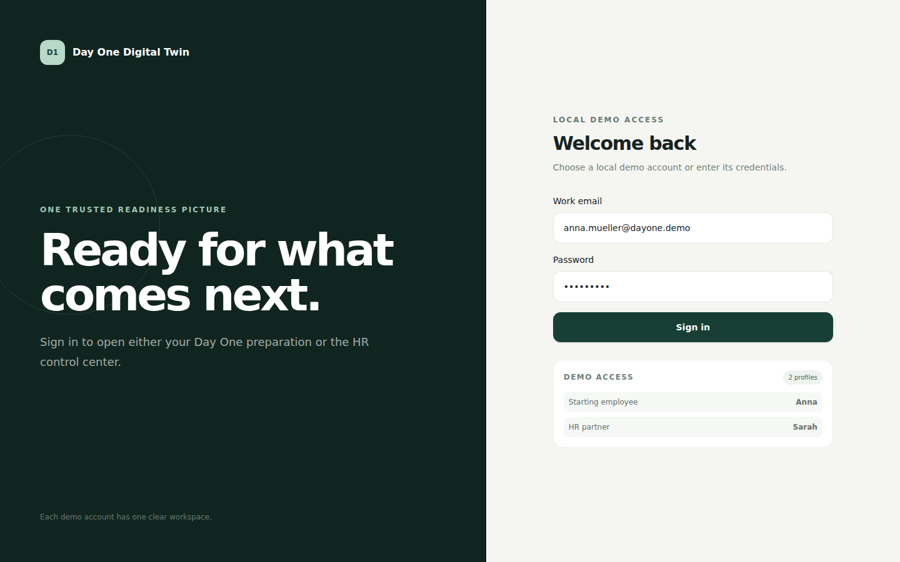
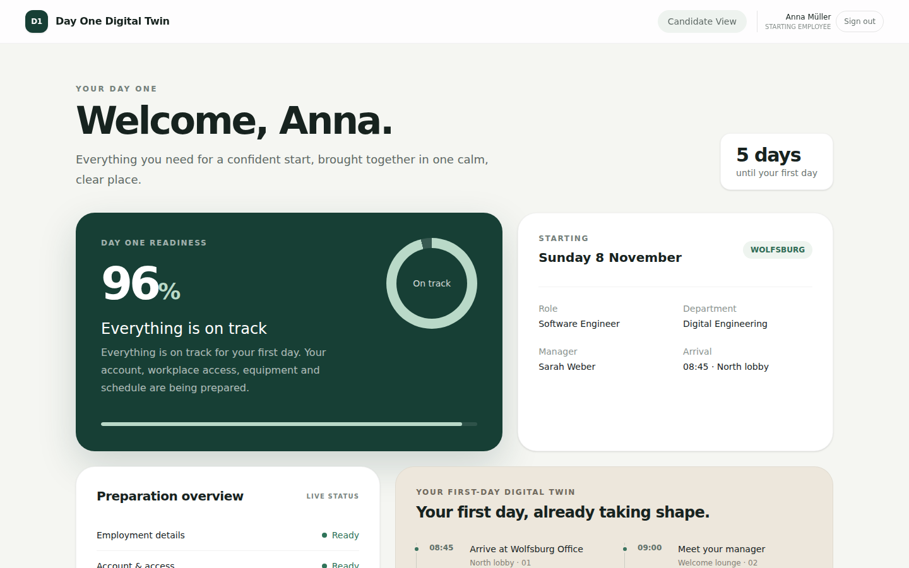
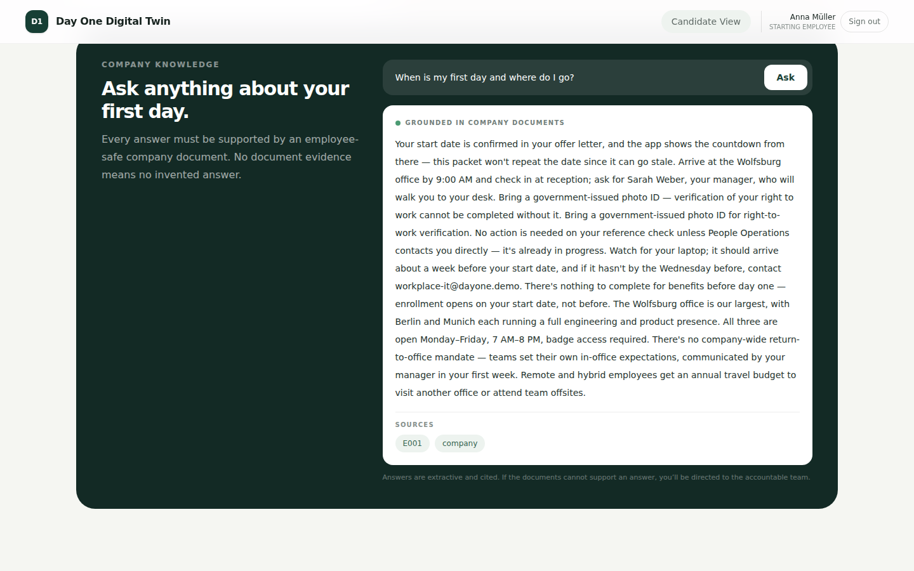
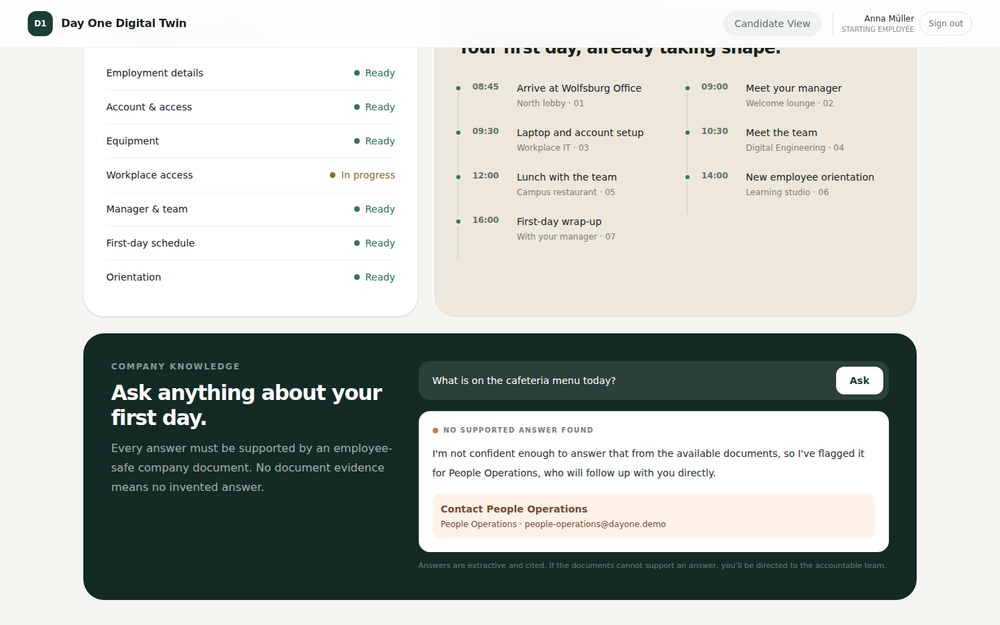
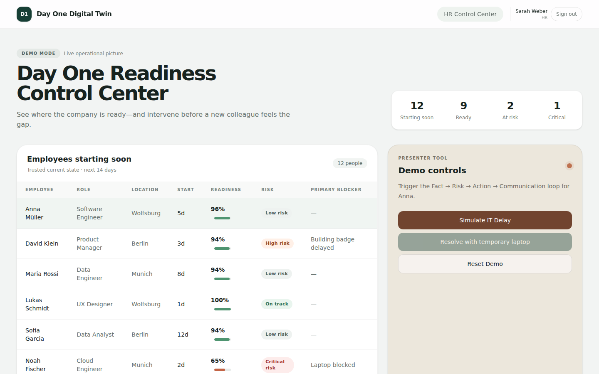
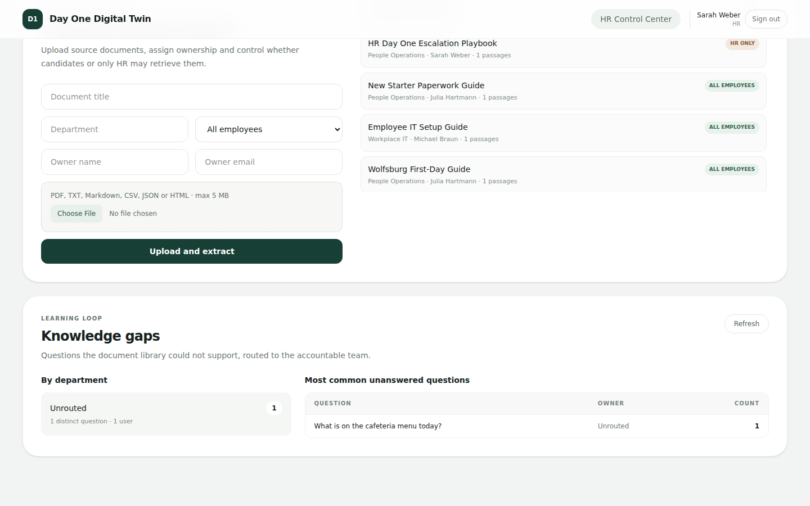
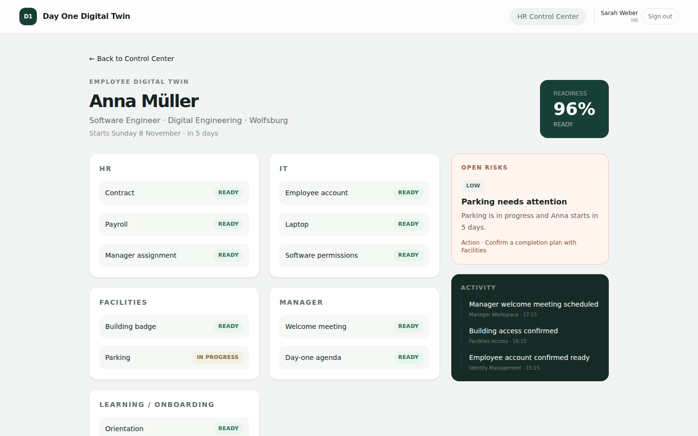

# Preboard — Day One Digital Twin

An onboarding assistant for people who have **signed a job offer but haven't started yet**.

- **New hires** see how ready their first day is, their Day One schedule, and can ask
  questions. Every answer is pulled from company documents and cites its source.
- **When it can't answer confidently**, it doesn't guess. It routes the question to the
  right team (IT, Facilities, People Operations…) and logs it.
- **HR** gets a control center: who starts soon, what's blocking them, and which
  questions the documents couldn't answer ("knowledge gaps").

> All people, companies and data in this repo are fictional demo content.

## Screenshots

| Login | Candidate dashboard |
|---|---|
|  |  |

| Answer with sources | No answer → handed off to a team |
|---|---|
|  |  |

| HR control center | Knowledge gaps |
|---|---|
|  |  |

| Employee detail (HR view) |
|---|
|  |

---

## Quick start (runs fully locally, no accounts needed)

### 1. Requirements

| Tool | Version | Check with |
|---|---|---|
| Python | 3.10+ | `python3 --version` |
| Node.js | **22.13+** (older versions fail) | `node -v` |
| make | any | `make -v` |

### 2. Install

```bash
git clone git@github.com:casgomp/preboard-ai-workforce.git
cd preboard-ai-workforce

python3 -m venv .venv
source .venv/bin/activate          # Windows: .venv\Scripts\activate

make install                       # pip install + npm install
```

### 3. Create the config files

```bash
cp .env.example .env
cp frontend/.env.example frontend/.env.local
```

Leave the values as they are. With no Databricks token, everything runs in **local
mode**: it reads the sample documents in `data/*.md` and uses a simple local answer
engine.

### 4. Run

```bash
make dev
```

This starts both parts together (Ctrl-C stops both):

- the Python backend on http://localhost:8000
- the web app on **http://localhost:3000** ← open this one

> Port 8000 already in use? Run `make dev PORT=8010` and set
> `PYTHON_API_URL=http://localhost:8010` in `frontend/.env.local`.

### 5. Try the demo

| Who | Email | Password | You'll see |
|---|---|---|---|
| New hire (Anna) | `anna.mueller@dayone.demo` | `Welcome5!` | Candidate dashboard + Q&A |
| HR (Sarah) | `sarah.weber@dayone.demo` | `PeopleOps!` | HR control center |

Suggested walkthrough:

1. Sign in as **Anna**. Ask *"When is my first day and where do I go?"* and you get an
   answer with its sources.
2. Ask *"What is on the cafeteria menu today?"*. The documents don't cover it, so the
   app hands the question off to a team instead of making something up.
3. Sign out, sign in as **Sarah**. Scroll down to **Knowledge gaps**: Anna's
   unanswered question is there.
4. In **Demo controls**, click **Simulate IT Delay**. Anna's readiness drops and a new
   risk appears. Click **Reset Demo** to undo.

---

## How it's built

```
Browser ──► frontend/ (Next.js, port 3000) ──► server.py (FastAPI, port 8000) ──► preboard/ (Python "brain")
                                                                                     │
                                                    local: data/*.md   ◄─────────────┤
                                                    or Databricks (Unity Catalog + LLM)
```

| Folder / file | What it is |
|---|---|
| `frontend/` | The web app (candidate + HR screens). See [`frontend/README.md`](frontend/README.md). |
| `server.py` | Small HTTP API the web app calls to answer questions. |
| `preboard/` | Core Python logic: `qa.py` (main flow), `retrieval.py` (find relevant text), `generation.py` (write the answer), `routing.py` (which team to hand off to), `wiring.py` (chooses local vs. Databricks automatically). |
| `data/*.md` | Sample offer packets (`E001` = Anna, `E002` = David…) plus `company.md` shared info. |
| `app.py` | Older Streamlit chat UI, kept as a fallback demo. |
| `tests/`, `frontend/tests/` | Test suites. |
| `NOTES.md` | Design log: why things are the way they are. |

### Other ways to run it

```bash
python -m preboard.cli --offer-id E001   # chat in the terminal as candidate E001
streamlit run app.py                     # fallback Streamlit chat UI
make dev-python                          # backend only
make dev-frontend                        # web app only
```

---

## Tests

```bash
make test           # runs everything below
make test-python    # python -m pytest (no credentials needed)
make test-frontend  # npm test + typecheck + lint
```

---

## Optional: connect to real Databricks

Only needed if you want real AI-generated answers, semantic search, and Unity Catalog
storage instead of local mode.

1. In `.env`, fill in:
   - `DATABRICKS_HOST` and `DATABRICKS_TOKEN` (your workspace + a personal access token)
   - `DATABRICKS_WAREHOUSE_ID` (or `DATABRICKS_HTTP_PATH`). Set one, not both.
   - `DATABRICKS_CATALOG` / `DATABRICKS_SCHEMA`: only if yours aren't
     `workspace` / `preboard`
2. Create and seed the tables once by running `frontend/databricks/setup_tables.sql`,
   then `seed_data.sql`, in your SQL warehouse.
   ⚠️ **Don't re-run `seed_data.sql` after a demo has started**: it wipes the tables.
3. Load the documents into Databricks (repeat whenever you edit `data/*.md`):
   ```bash
   make ingest
   ```
4. `make dev` as usual. `preboard/wiring.py` switches to Databricks automatically when
   credentials are present. There's no separate "prod mode" flag.

To also put the web app's HR data on Databricks, set `DATA_MODE=databricks` and/or
`DOCUMENT_MODE=databricks` in `frontend/.env.local`.

Integration tests against a real workspace:

```bash
RUN_DATABRICKS_INTEGRATION_TESTS=1 python -m pytest tests/test_databricks_integration.py
```

### Deploy (Streamlit fallback only)

```bash
make deploy        # = databricks bundle deploy && databricks bundle run preboard
databricks apps logs preboard   # always check the logs after deploying
```

This deploys `app.py` only, using `databricks.yml` and `app.yaml`. The Next.js web app
and `server.py` are local-only in this build.

---

## Auth notes

- **Web app:** session-cookie login with the demo accounts above (see
  `frontend/services/auth/session.ts`). A real rollout would use company SSO.
- **CLI / Streamlit:** a signed magic-link token per candidate:
  ```bash
  python -m preboard.cli --issue-token E001
  python -m preboard.cli --token <token>
  streamlit run app.py   # then open http://localhost:8501/?token=<token>
  ```
  `--offer-id` skips the token check and is for local development only.
- `PREBOARD_AUTH_SECRET` can stay empty locally. The deployed app needs a real secret.

## Troubleshooting

| Problem | Fix |
|---|---|
| `npm run dev` fails / syntax errors on start | Node is too old. Install Node 22.13+ (e.g. `nvm install 22`). |
| `make dev` says `.env: No such file` | You skipped step 3: `cp .env.example .env`. |
| Login page reloads instead of signing in | Wait a few seconds after the first page load; the dev server is still compiling. |
| Candidate questions fail with a connection error | The Python backend isn't running on the port in `PYTHON_API_URL`. |
